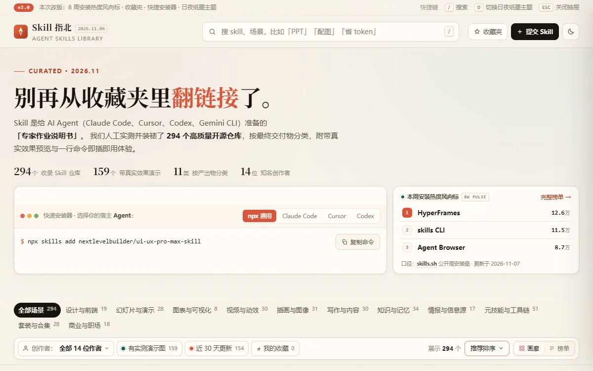
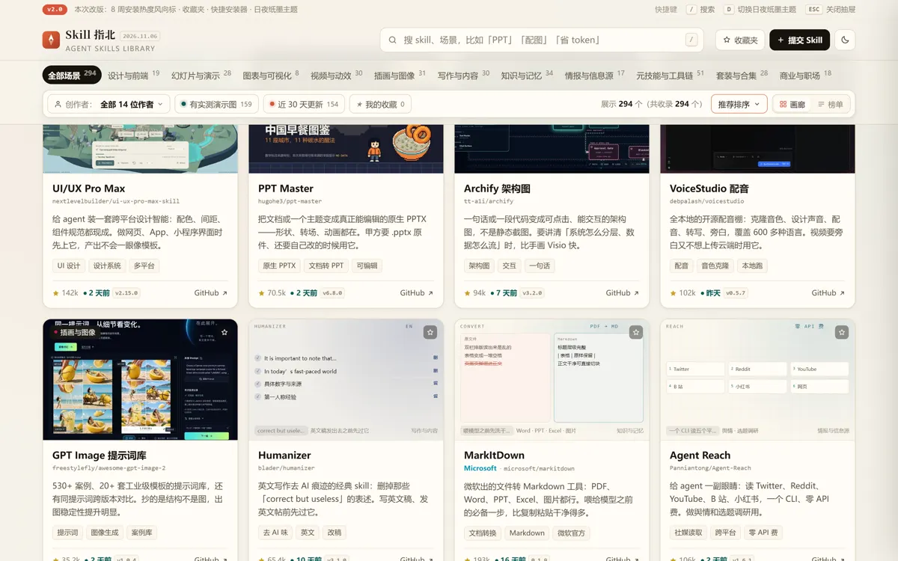
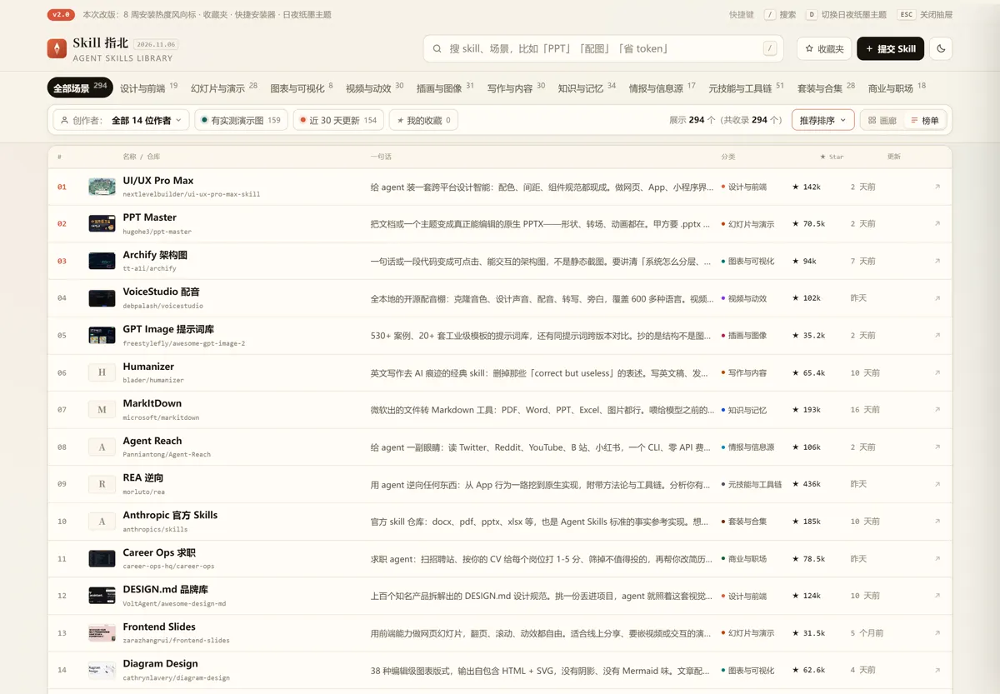
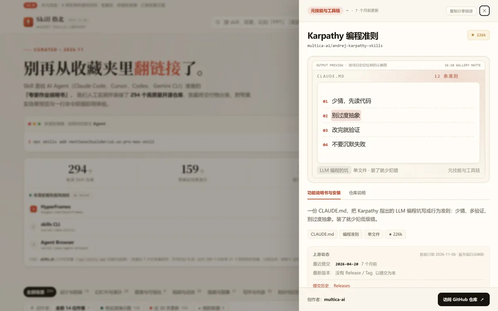
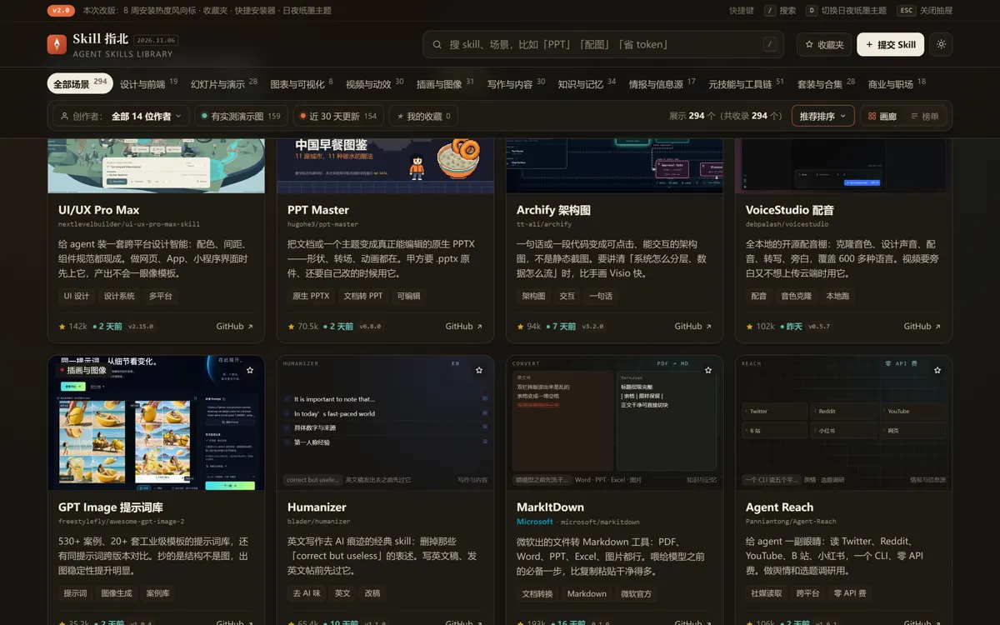
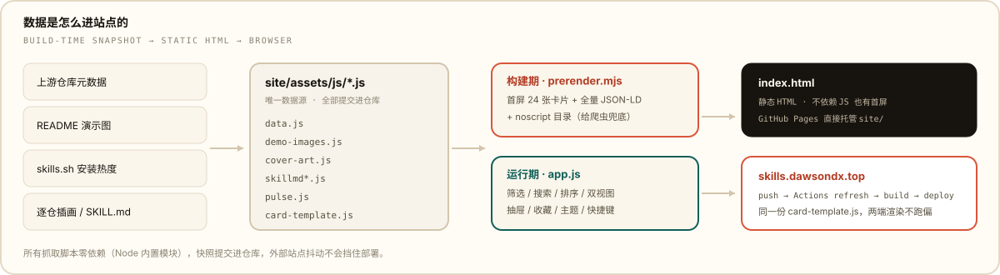

# Skill 指北

> **别再从收藏夹里翻链接了。**
> 给 AI Agent（Claude Code、Cursor、Codex、Gemini CLI）用的开源 Skills 精选库：按「你最后要做出什么」分类，附真实效果预览与一行命令即插即用。

🌐 **[在线站点：skills.dawsondx.top](https://skills.dawsondx.top/)** · 收录 **323** 个仓库 · **11** 个产出物分类 · **17** 位创作者 · 纯静态、零前端依赖



---

## 这是什么

开源 Agent Skill 越来越多，但找起来很费劲：仓库名看不出能干嘛，README 里全是徽章，装之前也不知道效果长什么样。

这个站点做的就是把它们**装裱成一本可以翻的目录**：

- 不按技术栈分类，按**最终交付物**分类 —— 做 PPT、画图表、剪视频、写公众号、管知识、做设计……
- 优先给**真实效果预览**：能拿到仓库自己的演示图就用真图，拿不到的就按这个仓库的定位单独画一张示意图
- 每条都配一句人话说明、标签、Star 数、最近提交，以及一条可以直接复制的安装命令
- 数据快照提交进仓库，**外部站点挂了也不影响站点本身**



---

## 五大高频场景速查（精选直达）

面向 **Claude Code、Cursor、Codex、Gemini CLI** 等 AI Agent 最常被问到的 5 类高频需求，先看结论直接挑：

| 高频场景 | 一句话选型建议 | 精选开源 Skill（点名称直达效果演示与安装命令） | 站内完整检索 |
|---|---|---|---|
| **做 PPT / 演示文稿** | 要交甲方可编辑 `.pptx` 选原生路线；线上分享/发布会选 HTML 网页幻灯片 | [PPT Master](https://skills.dawsondx.top/?open=ppt-master) · [Anthropic 官方 PPTX](https://skills.dawsondx.top/?open=anthropics-pptx) · [Frontend Slides](https://skills.dawsondx.top/?open=frontend-slides) · [归藏 PPT](https://skills.dawsondx.top/?open=guizang-ppt) · [HTML PPT Studio](https://skills.dawsondx.top/?open=html-ppt) · [Gorden PPT](https://skills.dawsondx.top/?open=gorden-ppt) | [做 PPT 全部方案 →](https://skills.dawsondx.top/?q=%E5%81%9APPT) |
| **去 AI 味 / 降 AI 率** | 中文长文去模板腔看 Humanizer-zh / Lieflat / 活人感写作；英文看 Humanizer / Stop Slop；网页视觉去 AI 味看 Hallmark | [中文去 AI 味](https://skills.dawsondx.top/?open=humanizer-zh) · [Lieflat 去 AI 味](https://skills.dawsondx.top/?open=larashero3-dotcom-lieflat-less-ai-tone) · [活人感写作](https://skills.dawsondx.top/?open=human-writing) · [Oil Tone](https://skills.dawsondx.top/?open=oil-tone) · [Humanizer](https://skills.dawsondx.top/?open=blader-humanizer) · [Hallmark](https://skills.dawsondx.top/?open=hallmark) | [去 AI 味全部方案 →](https://skills.dawsondx.top/?q=%E5%8E%BBAI%E5%91%B3) |
| **画架构图与技术图** | 要交互式架构图用 Archify；告别丑 Mermaid 味出 SVG 用 Diagram Design / Guage；要手工二改用 draw.io / Excalidraw | [Archify 架构图](https://skills.dawsondx.top/?open=tt-a1i-archify) · [Diagram Design](https://skills.dawsondx.top/?open=diagram-design) · [Fireworks 技术图](https://skills.dawsondx.top/?open=fireworks-graph) · [draw.io 生成器](https://skills.dawsondx.top/?open=drawio) · [Excalidraw 图表](https://skills.dawsondx.top/?open=excalidraw) · [Guage SVG](https://skills.dawsondx.top/?open=guage1029-guage-svg-gen) | [画架构图全部方案 →](https://skills.dawsondx.top/?q=%E7%94%BB%E6%9E%B6%E6%9E%84%E5%9B%BE) |
| **省 Token / 降本提效** | 长会话压输出约 65% 选 Caveman；跨会话记忆省背景重复选 Claude Mem；给 Skill 减肥选 Agent Scripts | [Caveman 省 Token](https://skills.dawsondx.top/?open=caveman) · [Claude Mem 持久记忆](https://skills.dawsondx.top/?open=claude-mem) · [Agent Scripts](https://skills.dawsondx.top/?open=steipete-agent-scripts) · [Answer me with HTML](https://skills.dawsondx.top/?open=qingyuna-answer-me-with-html) · [Karpathy 编程准则](https://skills.dawsondx.top/?open=karpathy-md) | [省 Token 全部方案 →](https://skills.dawsondx.top/?q=%E7%9C%81token) |
| **公众号写作与排版** | 已有 Markdown 一键出微信排版选 gzh-design；抓热点到进草稿箱全流程选 WeWrite；配图封面选归藏社媒卡片 / 小黑配图 | [公众号排版](https://skills.dawsondx.top/?open=gzh-design) · [WeWrite 全流程](https://skills.dawsondx.top/?open=wewrite) · [AI 公众号工作流](https://skills.dawsondx.top/?open=ai-wechat) · [归藏社媒卡片](https://skills.dawsondx.top/?open=social-card) · [小黑怪诞配图](https://skills.dawsondx.top/?open=xiaohei-illustration) | [写公众号全部方案 →](https://skills.dawsondx.top/?q=%E5%86%99%E5%85%AC%E4%BC%97%E5%8F%B7) |

### AI / Agent 机器可读入口

如果你正在让 AI 助手、Coding Agent 或检索脚本读取本站数据，可直接消费以下静态接口（每日自动随快照更新）：

- **精简站点地图（LLM 友好）**：<https://skills.dawsondx.top/llms.txt>
- **全量完整清单（纯文本 Markdown）**：<https://skills.dawsondx.top/llms-full.txt>
- **结构化 JSON 目录**：<https://skills.dawsondx.top/api/skills.json>
- **标准站点地图**：<https://skills.dawsondx.top/sitemap.xml>

---

## 主要功能

| 功能 | 说明 |
|---|---|
| 场景筛选 | 11 个分类横向 tab，带每类数量；桌面端自动折行，窄屏可横滑 |
| 组合筛选 | 创作者下拉、有演示图 / 近 30 天更新 / 我的收藏三个开关，可一键重置全部条件 |
| 排序 | 推荐排序（分类轮转，避免同一类霸榜）、Star、最近更新、安装热度 |
| 双视图 | **画廊**（装裱式卡片）／ **榜单**（表格化网格行，点表头即可排序） |
| 分页 | 桌面 **24 / 页**（4 列 × 6 行，正好等于构建期预渲染的 24 张静态首屏），≤900px **12 / 页**；页码写进 `?page=`，筛选变化自动回第 1 页，榜单排名跨页连续 |
| 搜索 | 搜名称、仓库、说明、标签；`/` 直接聚焦 |
| 详情抽屉 | 三段式侧滑面板：效果预览、功能说明书、SKILL.md / README 源码透视、安装命令、宿主兼容、同类替代 |
| 快速安装器 | 切换 npx / Claude Code / Cursor / Codex，命令实时变化，一键复制 |
| 安装热度风向标 | 首屏 Top3 迷你榜，可展开完整榜单；数据取自 `skills.sh` 公开周安装量快照 |
| 收藏夹 | 存在浏览器 `localStorage`，不登录、不上传 |
| 日夜纸墨主题 | `D` 一键切换，浅色暖纸 / 深色墨色两套同名设计变量 |
| 分享深链 | `?open=<id>` 可直接打开某个 skill 的详情，`?view=list` 直接进榜单 |
| 回首页 | 点顶栏 logo / 站名，清空全部筛选与深链、关掉抽屉并平滑回到页面顶部 |



---

## 详情抽屉

点任意卡片会从右侧滑出详情面板：固定的元数据头、独立滚动的正文、常驻的尾部 CTA。



正文分两个 tab：

- **功能说明书与安装** —— 描述、标签、上游动态（最近提交 / 版本 / Releases）、一键安装命令、宿主兼容矩阵、同作者作品与同类替代
- **SKILL.md 源码透视 / 仓库说明** —— 有真 `SKILL.md` 就看源码前 24 行；没有则展示从 README 清洗出的纯文本摘要（已去掉图片、徽章与代码块）

抽屉的完整设计拆解、与样板的逐项对照、以及迁移实施记录见 👉 **[docs/drawer-spec.md](docs/drawer-spec.md)**。



---

## 设计语言

| 维度 | 取值 |
|---|---|
| 底色 | 暖纸 `#F7F3EA` / 纸面 `#FFFCF6` / 凹槽 `#FBF6EC` |
| 主色 | 珊瑚橙 `#D9553A`（涨、强调）· 墨青 `#0F5F58` |
| 文字 | 三级：`#17130E` / `#57503F` / `#8A8271`，行高 ≥ 1.4 |
| 字体 | 正文系统无衬线，标题宋体，数字与命令等宽 |
| 圆角 / 阴影 | 四级圆角 + 三级阴影 |
| 动效 | 卡片 `300ms cubic-bezier(0,0,.2,1)`；遮罩 200ms 先落定；尊重 `prefers-reduced-motion` |
| 暗色 | `:root[data-theme="dark"]` 覆盖同一套变量，不需要写第二份组件样式 |

---

## 快速开始

### 直接看

打开 <https://skills.dawsondx.top/>，或者本地直接双击 `site/index.html`（静态页，`file://` 也能跑）。

### 本地起服务

```bash
cd site
npm start                 # node server.mjs，默认 http://localhost:3000
```

`server.mjs` 是零依赖的 Node HTTP 服务，只做一件事：代理 GitHub 上游动态（浏览器直连 `commits.atom` 会被 CORS 拦、匿名 API 又限流）。它用 stale-while-revalidate，首屏永远不等抓取。

> 在 GitHub Pages 上这个接口不存在（`/api/upstream` 404），页面会自动回落到仓库里提交的快照数据，功能不受影响。

### 快捷键

| 键 | 作用 |
|---|---|
| `/` | 聚焦搜索框 |
| `D` | 切换日夜纸墨主题 |
| `ESC` | 关闭抽屉 / 弹层 |

### 改了卡片模板之后

`card-template.js` 是**构建期和浏览器共用**的同一份实现，所以改完必须重跑预渲染，否则首屏静态卡片会和 JS 渲染长得不一样：

```bash
node _tools/prerender.mjs
```

---

## 项目结构

```
.
├── site/                       ← GitHub Pages 直接托管这个目录
│   ├── index.html              ← 页面骨架（含构建期注入的首屏 24 张卡片 + JSON-LD）
│   ├── server.mjs              ← 可选：零依赖上游数据代理（本地 / 自托管用）
│   ├── server/                 ← seed.json / cache.json / upstream.mjs
│   └── assets/
│       ├── css/style.css       ← 全部样式与主题变量
│       ├── js/
│       │   ├── data.js         ← 323 条仓库主数据（唯一真相源）
│       │   ├── demo-images.js  ← 从仓库 README 补抓的演示图清单
│       │   ├── cover-art.js    ← 135 个无图仓库的逐仓插画设计稿
│       │   ├── card-template.js← 卡片 HTML 模板（前端 + 预渲染共用）
│       │   ├── skillmd-index.js / skillmd.js  ← 源码快照索引 / 正文（按需加载）
│       │   ├── search-index.js ← 离线构建的语义搜索索引（JTBD 意图 / 概念簇 / Top-5 近邻）
│       │   ├── search-engine.js← 零依赖混合搜索引擎（归一化 / 分词 / 极性保护 / 加权排序）
│       │   ├── pulse.js        ← 每周安装热度
│       │   └── app.js          ← 全部交互
│       └── img/                ← 163 张自托管演示图（已压成 WebP）
├── _tools/                     ← 零依赖抓取与构建脚本（Node 内置模块，无需 npm install）
├── docs/
│   ├── drawer-spec.md          ← 详情抽屉的系统研究与迁移对照说明
│   └── img/                    ← 本文档插图
└── .github/workflows/pages.yml ← 定时刷新 + 构建 + 部署
```

---

## 数据是怎么来的



四类上游数据被抓成 JS 快照提交进仓库，构建期预渲染和浏览器运行期消费的是**同一份数据**：

| 数据 | 来源 | 脚本 |
|---|---|---|
| 仓库清单 / 分类 / 创作者 / Star | 人工筛选 + 上游快照 | `fetch-upstream.mjs` |
| 演示图 | 各仓库 README 里的图片，下载校验尺寸后自托管 | `fetch-demo-images.mjs` |
| 逐仓插画 | 人工按每个仓库定位单独设计，DOM 微版式而非生成图片 | `cover-art.js` |
| SKILL.md / README 摘要 | `raw.githubusercontent.com`，失败自动回落 | `fetch-skillmd.mjs` |
| 每周安装热度 | `skills.sh` 首页公开 RSC 载荷（匿名 `npx skills add` 遥测） | `fetch-pulse.mjs` |

**构建期** `prerender.mjs` 用 `node:vm` 加载同一份 `card-template.js`，把推荐排序前 24 张卡片、全量 `schema.org/ItemList` JSON-LD 和 `<noscript>` 目录直接写进 `index.html` —— 首屏不依赖 JS，爬虫也能拿到完整内容。

所有抓取脚本都遵循同一条原则：**快照提交进仓库，外部站点抖动不挡部署**。CI 里刷新失败会沿用上次数据并继续发布。

---

## 常用命令

| 命令 | 作用 |
|---|---|
| `node _tools/add-skill.mjs inspect <url>` | 侦察新仓库（GitHub 取数 / 防重 / 作者准入侦察） |
| `node _tools/add-skill.mjs commit <json>` | 一键收录新 Skill（写入数据 / 补图与 SKILL.md / 语义搜索 / 预渲染 / 验收） |
| `node _tools/build-search-index.mjs` | 重建离线语义搜索索引（可选 `--llm` 为新增条目增量扩充意图） |
| `node _tools/eval-search.mjs --strict` | 跑 34 条黄金查询集的搜索质量 A/B 评测 |
| `node _tools/prerender.mjs` | 重生成首屏卡片 / JSON-LD / noscript（改模板后必跑） |
| `node _tools/prerender.mjs --check` | 只校验不写盘，CI 可用 |
| `node _tools/build-seo.mjs` | 生成 `robots.txt`、`sitemap.xml`、`llms.txt`、`llms-full.txt`、`api/skills.json` |
| `node _tools/ping-indexnow.mjs` | 向 IndexNow（Bing / AI 搜索）推送最新 URL（支持 `--dry` 预览） |
| `node _tools/fetch-upstream.mjs --write` | 刷新仓库最近提交 / 版本 / Star |
| `node _tools/fetch-demo-images.mjs` | 补抓演示图（`--limit 10` 先试跑） |
| `node _tools/fetch-skillmd.mjs` | 重抓 SKILL.md / README 摘要（约 40 秒） |
| `node _tools/fetch-pulse.mjs` | 刷新安装热度榜 |
| `node _tools/optimize-images.mjs` | 把大图压成 WebP |
| `npm start`（在 `site/` 下） | 起本地服务 |

---

## 构建与部署

`.github/workflows/pages.yml` 在 `push`、每天定时和手动触发时跑：

1. **refresh**（仅定时 / 手动）—— 刷新上游快照与源码快照，有变化才提交回 `main`
2. **build** —— `prerender.mjs` 重生成静态首屏与 SEO 数据，顺手刷一次安装热度，上传 `site/` 作为 Pages 产物
3. **deploy** —— 发布到自定义域 `skills.dawsondx.top`

`push` 事件会跳过 refresh，直接用仓库里已提交的快照，保证每次部署都快且可复现。

---

## 版权与致谢

- 站内所有 Skill 均来自各自的开源仓库，**版权归原作者所有**；中文说明由本站撰写，仅作导航介绍。
- `site/assets/img/` 里的演示图版权归各仓库作者，此处仅作效果展示。
- 逐仓插画（`cover-art.js`）为本站按项目定位手工绘制的示意图，不是仓库原始截图，卡片上会明确标注。

如果某个仓库的说明写错了、想补充一个值得收录的仓库，欢迎提 Issue 或 PR；站点右下角也有「提交 skill」入口。

---

## 相关文档

- [详情抽屉设计与实现对照说明](docs/drawer-spec.md) —— 样板页拆解、样式/动效/响应式实测、功能与状态梳理、P1–P4 迁移记录与验收清单
- [在线站点](https://skills.dawsondx.top/)
